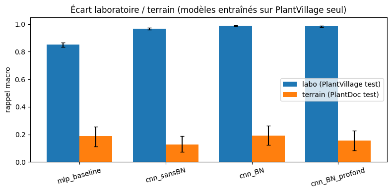
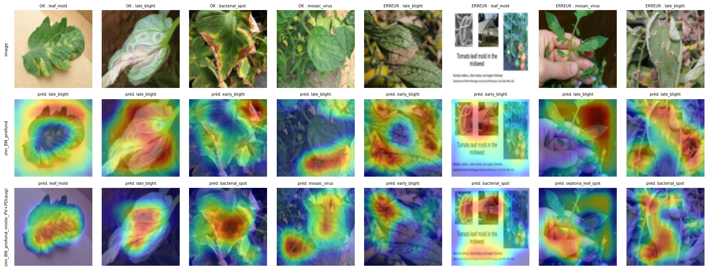

# Détection des maladies de la tomate par CNN : du laboratoire au terrain

Projet de fin de module Deep Learning (cohorte 3 AI hub). Un classifieur CNN **conçu from scratch** (PyTorch, sans transfer learning)
est entraîné sur **PlantVillage** (photos de laboratoire) puis évalué aussi sur **PlantDoc** (photos de terrain).
Question centrale : *comment construire un modèle qui fonctionne vraiment dans un champ ?*

## Résultat principal

Un modèle excellent en laboratoire s'effondre sur le terrain : entraîné sur PlantVillage seul, le CNN tombe **au niveau du hasard**
(rappel macro 0,13 à 0,19 pour 8 classes, hasard = 0,125). L'entraînement mixte PlantVillage + PlantDoc est la seule stratégie qui améliore
nettement le terrain, sans sacrifier le laboratoire, mais reste insuffisant pour un usage autonome.

| Expérience | Labo : rappel macro (IC 95 %) | Terrain : rappel macro (IC 95 %) |
|---|---|---|
| MLP (baseline) | 0,851 (0,835–0,867) | 0,189 (0,112–0,257) |
| CNN 3 blocs, avec BN | 0,989 (0,985–0,993) | 0,193 (0,122–0,265) |
| CNN 4 blocs, avec BN (base) | 0,983 (0,978–0,989) | 0,156 (0,085–0,226) |
| Base + augmentation + changement de fond | 0,946 (0,937–0,955) | 0,243 (0,140–0,359) |
| Ré-entraînement sur 100 % de PlantDoc | 0,603 (0,581–0,623) | 0,251 (0,139–0,370) |
| **Entraînement mixte PlantVillage + PlantDoc** | 0,973 (0,966–0,979) | **0,451 (0,326–0,579)** |

Test de laboratoire : 3 028 images ; test de terrain : **66 images seulement** (intervalles de confiance par bootstrap, à lire avant toute conclusion).
Le tableau complet, les courbes, les matrices de confusion, les erreurs et les Grad-CAM sont dans le notebook et dans `outputs/figures/`.




## Contenu du dépôt

```
notebooks/projet_cnn_tomate.ipynb   notebook reproductible, exécuté (étapes 2 à 5 de l'énoncé)
scripts/download_data.py            téléchargement + préparation des données (manifestes CSV, splits sans fuite)
requirements.txt                    dépendances
outputs/figures/                    figures produites par le notebook
```

## Exécution (Colab ou Kaggle, runtime GPU)

1. Ouvrir le notebook dans Colab : menu *Fichier → Ouvrir le notebook → GitHub*, coller l'URL de ce dépôt, choisir `notebooks/projet_cnn_tomate.ipynb`.
2. Activer un GPU : *Exécution → Modifier le type d'exécution → GPU* (Kaggle : *Accelerator : GPU* et *Internet : On*).
3. Lancer *Exécution → Tout exécuter*. Le notebook clone ce dépôt si besoin (variable `REPO_URL` de la cellule de configuration), puis appelle
   `scripts/download_data.py` pour télécharger et préparer les données (≈ 10 min). Commande manuelle équivalente :
   `python scripts/download_data.py --data-dir data --seed 42`.
4. Test rapide du pipeline : `DEBUG = True` dans la cellule de configuration (quelques minutes), puis `False` pour les vrais résultats
   (≈ 55 min sur un GPU T4 avec les réglages par défaut).

Les graines sont fixées (`SEED = 42`), mais les opérations GPU ne sont pas strictement déterministes : de petits écarts entre exécutions sont normaux.

## Données et choix méthodologiques

| Jeu | Source | Usage |
|---|---|---|
| PlantVillage | Hugging Face `geraldmc/plantvillage-full` (réédition CC0 des images `raw/color/` du dépôt `spMohanty/PlantVillage-Dataset`, avec identifiant de feuille) | laboratoire, fond uniforme |
| PlantDoc (version classification) | GitHub `pratikkayal/PlantDoc-Dataset` | terrain, fonds chargés |

* **Culture : tomate**, **8 classes** communes : healthy, bacterial_spot, early_blight, late_blight, leaf_mold, septoria_leaf_spot,
  yellow_leaf_curl_virus, mosaic_virus. *Target spot* (absente de PlantDoc) et *spider mites* (2 images dans PlantDoc, 0 en test) sont exclues.
* **Pas de fuite de données.** PlantVillage : split groupé par feuille, validation prélevée par feuille ; le regroupement n'est réel que pour une
  partie des images selon la classe (mosaic_virus 0 %, late_blight 48 %, yellow_leaf_curl_virus 51 %, septoria_leaf_spot 57 %, healthy 63 %,
  early_blight 99,9 %, bacterial_spot et leaf_mold 100 %) : une fuite résiduelle est possible pour les autres classes.
  PlantDoc : split officiel conservé, **3 groupes d'images identiques entre train et test retirés** (dont une image avec deux étiquettes contradictoires).
  Le test PlantDoc n'est jamais utilisé pour choisir un modèle.
* **Métrique principale : rappel macro**, justifiée par le coût asymétrique des erreurs (maladie manquée > fausse alerte). Précision, rappel et F1 par classe,
  taux de maladie manquée et de fausse alerte, intervalles de confiance bootstrap. L'accuracy n'est jamais un critère de conclusion.

## Limites principales

Test de terrain minuscule (66 images) et partiellement bruité (diapositives, pages de document, mains, filigranes) ; une seule graine ; une culture, 8 classes ;
heuristique de changement de fond imparfaite ; résolution de 96 px ; confiance non calibrée. Détails dans le rapport technique.

## Références

* Mohanty, Hughes, Salathé (2016). *Using Deep Learning for Image-Based Plant Disease Detection*. Frontiers in Plant Science.
* Singh et al. (2020). *PlantDoc: A Dataset for Visual Plant Disease Detection*. ACM CoDS-COMAD.
* Selvaraju et al. (2017). *Grad-CAM: Visual Explanations from Deep Networks via Gradient-based Localization*. ICCV.

> Ce prototype fournit un **diagnostic préliminaire** : il ne remplace ni un conseiller agricole ni un test de laboratoire.
